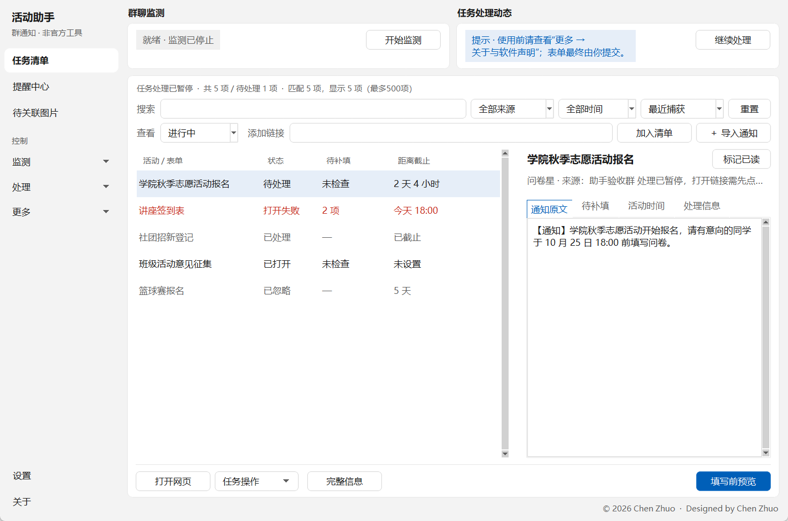
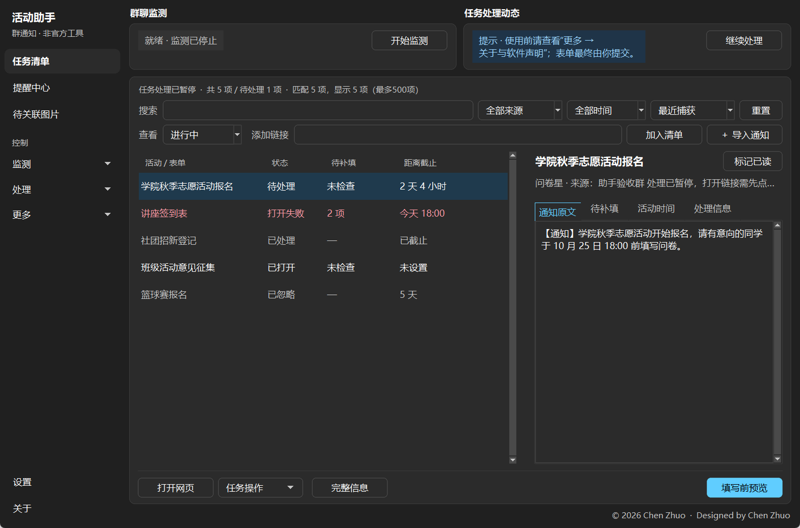
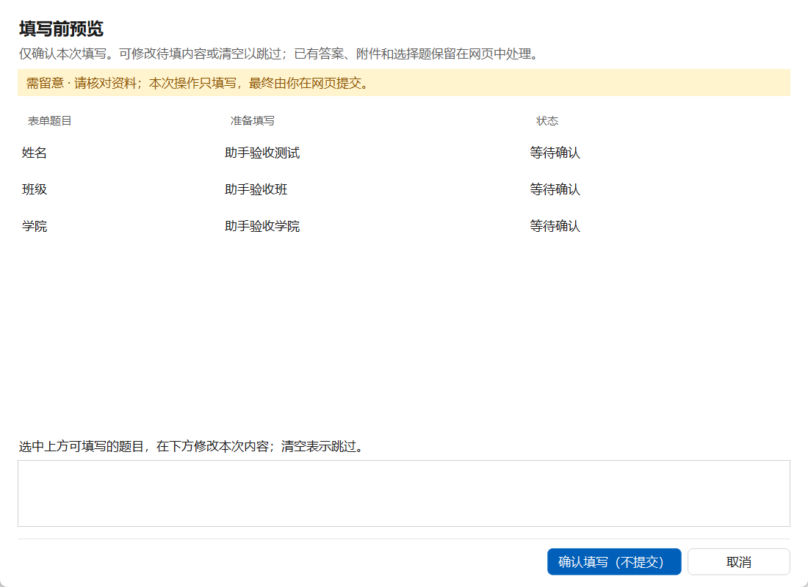
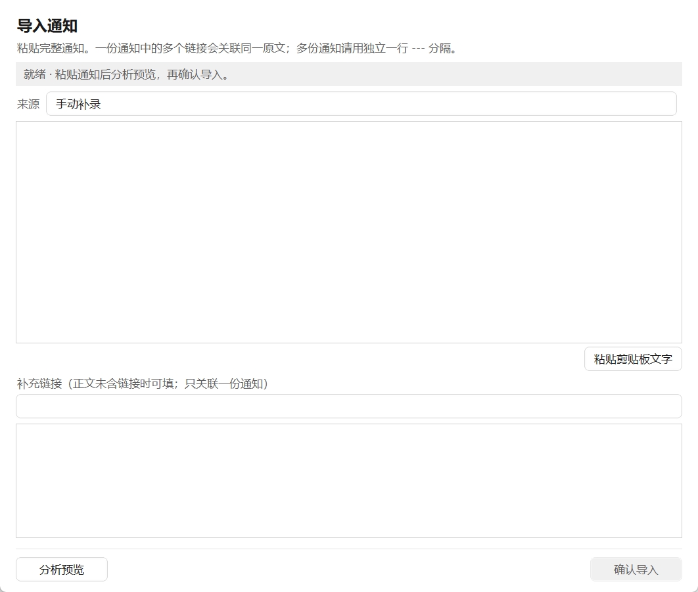

# 群活动填表助手

一个 Windows 桌面小工具：读取桌面聊天客户端里**目标群**的可见文字通知，把其中的活动报名链接整理成任务清单，提醒截止时间，并在你确认后**辅助填写**报名表单。最终提交始终由你自己在网页上完成。

> 非官方工具。与任何即时通讯软件厂商、在线文档或问卷平台、学校及学生组织均无隶属或授权关系。



<details><summary>更多截图</summary>

| 深色主题 | 填写前预览 | 导入通知 |
|---|---|---|
|  |  |  |

</details>

## 功能

- **捕获通知**：监测设置中的目标群，识别腾讯收集表、腾讯在线表格、金山文档的 HTTPS 分享链接，保存通知原文并合并重复链接；也可以粘贴通知文字手动导入。
- **任务清单**：搜索、筛选、备注与准备清单、活动时间和截止提醒、活动图片管理。
- **填写前预览**：按个人资料和自定义资料匹配表单题目，逐项核对、修改后才会填写；**只填写，不提交**。
- **本地数据**：所有数据保存在本机程序目录下的 `data` 文件夹；支持备份恢复、数据清理、一键清除全部数据。
- 浅色 / 深色主题，适配 100%–200% 显示缩放。

还不支持的功能和实验性功能见 [`app/功能支持说明.txt`](app/功能支持说明.txt)。

## 运行要求

- Windows 10/11 x64
- Microsoft Edge（用于打开和填写表单）
- 一个提供 Windows 辅助功能（UI Automation）文字的桌面聊天客户端。在“设置 → 群聊监测”中选择它的程序文件，打开目标群，并保持聊天窗口展开、不要最小化。

## 从源码运行

需要 Python 3.12：

```powershell
cd app
py -3.12 -m venv .venv
.venv\Scripts\python.exe -m pip install -r requirements.txt
.venv\Scripts\python.exe app.py
```

运行测试：

```powershell
.venv\Scripts\python.exe -B -m unittest discover -s tests
```

打包成 EXE 和安装程序的方法见 [`app/BUILD.md`](app/BUILD.md)；安装 / 卸载程序的源码在 [`installer/`](installer/)。

## 目录

| 路径 | 内容 |
|---|---|
| `app/` | 应用源码、测试、使用说明、软件声明、隐私说明、第三方许可证 |
| `installer/` | 用户级安装程序与卸载程序（不需要管理员权限） |
| `docs/screenshots/` | 截图（示例数据） |

## 隐私与安全

- 只读取你手动开启监测后、目标群当前可见的界面文字；不读取聊天客户端的进程内存或缓存，不切换聊天，不发送消息。
- 不自动提交表单，不绕过登录或验证码。
- 没有账号、云同步或遥测；资料只保存在本机，以明文存储，请自行保管电脑。详见 [`app/隐私说明.txt`](app/隐私说明.txt)。

## 开发说明

本项目在开发过程中大量借助了 AI 编程工具（OpenAI Codex / GPT 与 Anthropic Claude），由作者提出需求、测试验收并决定发布。

## 反馈

请在 [Issues](https://github.com/cz-303/group-activity-form-helper/issues) 提交。Issues 是公开的，请不要附带个人资料、群聊记录或 `data` 文件夹内容。

## 许可证

本项目源代码以 [MIT 许可证](LICENSE) 发布。第三方组件按各自许可证使用，见 [`app/THIRD_PARTY_NOTICES.md`](app/THIRD_PARTY_NOTICES.md) 与 `app/third_party/licenses/`。

Designed by Chen Zhuo
